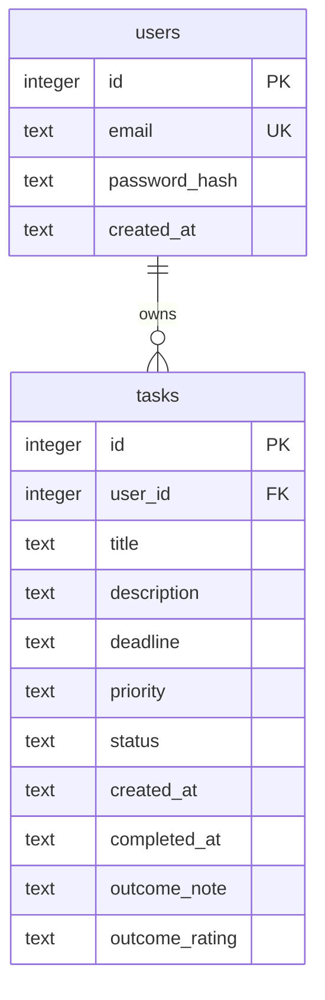

# ERD — Personal Task Management

Nguồn: `docs/plan.md`. File này là đặc tả database để code. Nếu lệch với lộ trình, làm theo file này.

Hai bảng. Một user có nhiều task. Không có bảng thứ ba.



## Bảng `users`

| Cột | Kiểu SQLite | Ràng buộc | Ý nghĩa |
| --- | --- | --- | --- |
| `id` | INTEGER | PRIMARY KEY | Khóa chính, SQLite tự tăng |
| `email` | TEXT | NOT NULL, UNIQUE COLLATE NOCASE | Định danh đăng nhập. App ghi chữ thường trước khi insert |
| `password_hash` | TEXT | NOT NULL | Chuỗi hash Argon2id. Không bao giờ trả về API |
| `created_at` | TEXT | NOT NULL, default UTC ISO-8601 | Thời điểm tạo user |

## Bảng `tasks`

| Cột | Kiểu SQLite | Ràng buộc | Ý nghĩa |
| --- | --- | --- | --- |
| `id` | INTEGER | PRIMARY KEY | Khóa chính |
| `user_id` | INTEGER | NOT NULL, FK → `users.id` ON DELETE CASCADE | Chủ task. Mọi câu SQL đọc/sửa/xóa đều lọc theo cột này |
| `title` | TEXT | NOT NULL, độ dài sau trim từ 1 đến 200 | Tiêu đề |
| `description` | TEXT | NOT NULL, default `''`, tối đa 2000 ký tự | Mô tả. Trống thì lưu chuỗi rỗng, không lưu NULL |
| `deadline` | TEXT | NULL được phép | Ngày `YYYY-MM-DD`, hoặc NULL nếu không có hạn |
| `priority` | TEXT | NOT NULL, default `medium` | Chỉ `low`, `medium`, `high` |
| `status` | TEXT | NOT NULL, default `todo` | Chỉ `todo`, `doing`, `done` |
| `created_at` | TEXT | NOT NULL, default UTC ISO-8601 | Thời điểm tạo task |
| `completed_at` | TEXT | NULL được phép | UTC ISO-8601 lúc việc vào `done`. NULL nếu chưa hoàn thành, đã mở lại, hoặc việc `done` từ trước khi có cột này. Không bịa mốc |
| `outcome_note` | TEXT | NULL được phép, tối đa 2000 ký tự | Ghi chú kết quả người dùng tự viết. Trống thì NULL, không lưu `""` |
| `outcome_rating` | TEXT | NULL được phép | `good`, `met`, `improve`. Đây là tự đánh giá, không phải điểm hệ thống tính |

Quan hệ: `users (1) — tasks (N)` qua `tasks.user_id`.

Không thêm `updated_at`. Không thêm bảng thứ ba: tổng quan đọc từ `tasks`.

Database đã tạo trước ba cột này được `ALTER TABLE` lúc mở kết nối. Dòng cũ giữ nguyên. Việc `done` cũ có `completed_at` NULL.

## Ràng buộc phải bật trong kết nối

`better-sqlite3` tắt foreign key theo mặc định của SQLite. Ngay sau khi mở file database:

```sql
PRAGMA foreign_keys = ON;
```

Thiếu dòng này thì `user_id` trỏ tới user không tồn tại vẫn insert được.

## DDL

Đặt trong `server/src/db/schema.sql`. Chạy một lần lúc khởi động server.

```sql
PRAGMA foreign_keys = ON;

CREATE TABLE IF NOT EXISTS users (
  id INTEGER PRIMARY KEY,
  email TEXT NOT NULL COLLATE NOCASE UNIQUE,
  password_hash TEXT NOT NULL,
  created_at TEXT NOT NULL DEFAULT (strftime('%Y-%m-%dT%H:%M:%fZ', 'now'))
);

CREATE TABLE IF NOT EXISTS tasks (
  id INTEGER PRIMARY KEY,
  user_id INTEGER NOT NULL,
  title TEXT NOT NULL CHECK (length(trim(title)) BETWEEN 1 AND 200),
  description TEXT NOT NULL DEFAULT '' CHECK (length(description) <= 2000),
  deadline TEXT CHECK (
    deadline IS NULL
    OR deadline GLOB '[0-9][0-9][0-9][0-9]-[0-9][0-9]-[0-9][0-9]'
  ),
  priority TEXT NOT NULL DEFAULT 'medium' CHECK (priority IN ('low', 'medium', 'high')),
  status TEXT NOT NULL DEFAULT 'todo' CHECK (status IN ('todo', 'doing', 'done')),
  created_at TEXT NOT NULL DEFAULT (strftime('%Y-%m-%dT%H:%M:%fZ', 'now')),
  completed_at TEXT,
  outcome_note TEXT CHECK (outcome_note IS NULL OR length(outcome_note) <= 2000),
  outcome_rating TEXT CHECK (
    outcome_rating IS NULL OR outcome_rating IN ('good', 'met', 'improve')
  ),
  FOREIGN KEY (user_id) REFERENCES users(id) ON DELETE CASCADE
);

CREATE INDEX IF NOT EXISTS idx_tasks_user_id ON tasks (user_id);
CREATE INDEX IF NOT EXISTS idx_tasks_user_status ON tasks (user_id, status);
CREATE INDEX IF NOT EXISTS idx_tasks_user_completed ON tasks (user_id, completed_at);
```

Index `idx_tasks_user_completed` nằm sau marker `-- migrate-then` trong `schema.sql`. File database cũ được thêm cột trước, rồi mới tạo index.

`CHECK` là lưới an toàn. Service vẫn phải kiểm tra trước và trả HTTP 400 với thông báo rõ. Ngày không tồn tại (ví dụ `2026-02-31`) qua được `GLOB`; service phải loại ngày đó.

## Quy tắc truy vấn

- Mọi câu lệnh task đều có `user_id = ?` lấy từ session. Không nhận `user_id` từ body.
- Sửa hoặc xóa: `WHERE id = ? AND user_id = ?`. Không thấy dòng thì 404, kể cả khi task thuộc user khác.
- Danh sách chỉ `WHERE user_id = ?`, rồi mới thêm filter status nếu có.
- Sắp xếp chỉ nhận whitelist: `created_at`, `deadline`, `priority`, `title`, `completed_at`. `order` chỉ `asc` hoặc `desc`.
- `completed_at` NULL luôn ở cuối, cùng kiểu với `deadline`: `ORDER BY completed_at IS NULL, completed_at ASC|DESC`.
- `priority` không sắp xếp theo alphabet (`high` đứng trước `low`). Dùng `CASE`: low = 1, medium = 2, high = 3.
- `deadline` NULL luôn ở cuối, cả khi tăng dần lẫn giảm dần: `ORDER BY deadline IS NULL, deadline ASC|DESC`.
- Mặc định khi không truyền query: `sort=created_at`, `order=desc`, không lọc status.

## Dữ liệu không lưu

Session nằm trong bộ nhớ tiến trình (`express-session` MemoryStore), không có bảng `sessions`. Restart server thì mọi phiên đăng nhập mất. Đủ cho mini project; không thêm session store.
