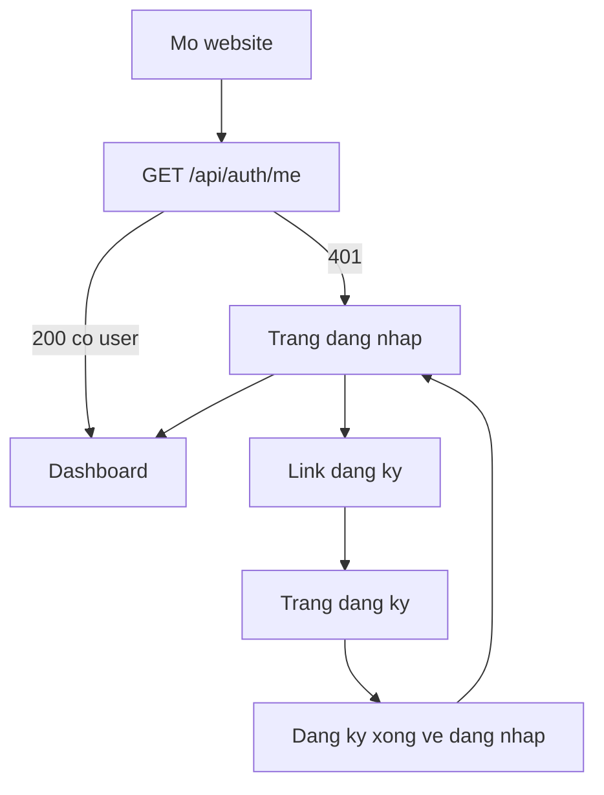
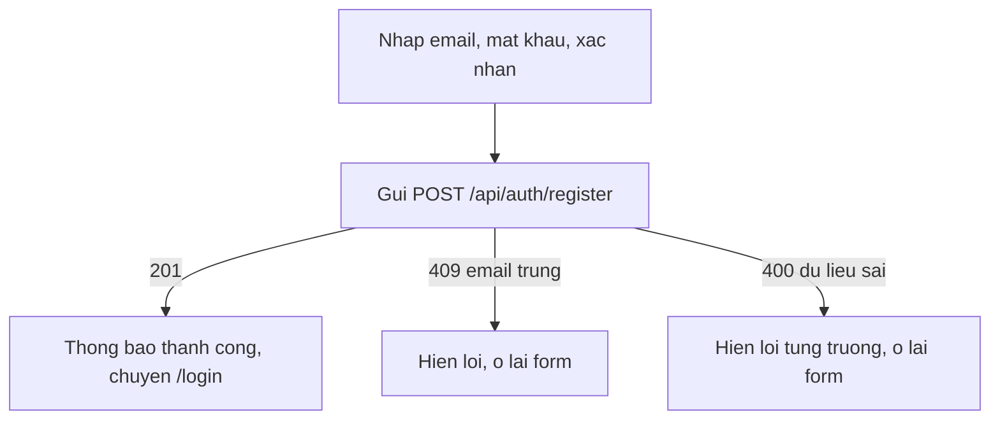
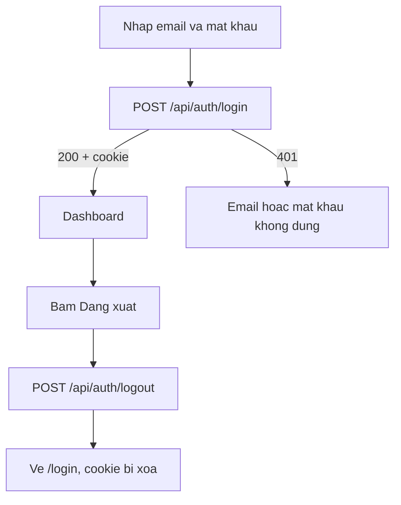
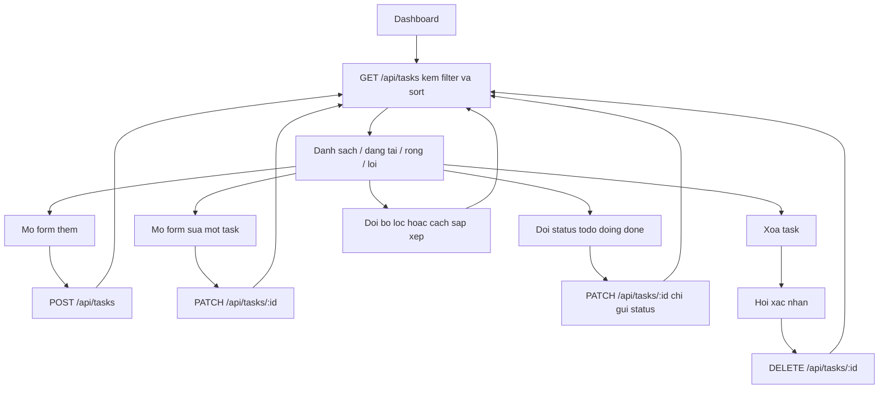

# User flow — Personal Task Management

Ba màn hình: Đăng ký, Đăng nhập, Dashboard. Không có Kanban, không kéo-thả.

Use case chi tiết nằm ở `docs/use-cases.md`. Sơ đồ dưới đây là đường đi trên giao diện.

## Màn hình

| Route | Màn | Ai vào được | Việc trên màn |
| --- | --- | --- | --- |
| `/register` | Đăng ký | Khách. Đã đăng nhập thì chuyển `/` | Form email, mật khẩu, xác nhận mật khẩu |
| `/login` | Đăng nhập | Khách. Đã đăng nhập thì chuyển `/` | Form email, mật khẩu. Link sang đăng ký |
| `/` | Dashboard | Đã đăng nhập. Khách bị chuyển `/login` | Danh sách task, lọc, sắp xếp, thêm, sửa, xóa, đổi trạng thái, đăng xuất |

Route lạ chuyển về `/login` nếu chưa có session, về `/` nếu đã đăng nhập.

## Vào app

Đăng ký không tự đăng nhập. Video demo đi đúng thứ tự: đăng ký, rồi đăng nhập.

## Đăng ký

## Đăng nhập và đăng xuất

Sai email và sai mật khẩu dùng cùng một câu. Không nói email nào đã tồn tại.

## Vòng đời task trên Dashboard

Sau mỗi lần ghi thành công, tải lại danh sách với filter và sort đang chọn. Không giữ bản sao task để tự sửa trên UI.

## Form, lọc, chữ trên màn hình

Bố cục, nhãn tiếng Việt, modal, nút nổi và dialog xóa nằm ở `docs/ui_docs/screens.md`. Màu và map sang query API nằm ở `docs/ui_docs/design-system.md`. Câu rỗng, lỗi và toast nằm ở `docs/ui_docs/ux-states.md`.

Luồng vẫn là: một form cho thêm và sửa, đổi trạng thái gửi ngay không mở form, xóa thì hỏi trước, đổi lọc hoặc sắp xếp thì gọi lại `GET /api/tasks`. Mặc định Tất cả và mới tạo trước. Task không có deadline đứng cuối khi sắp theo hạn.

## Việc giao diện không làm

- Không quyết định task thuộc user nào. Không gửi `userId`.
- Không lọc task của người khác trên client. API đã chỉ trả task của session.
- Không tự tính quyền. Nút hiện cho task đang thấy vì API chỉ gửi task của mình.
